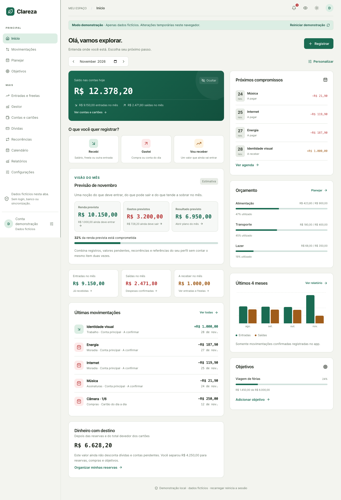

# Clareza — demonstração de finanças pessoais

Aplicação interativa em português para organizar receitas, despesas, cartões e objetivos. Esta edição de portfólio funciona **inteiramente no navegador**, com um cenário fictício pronto para explorar e sem conexão com o aplicativo original.

> Apenas dados fictícios. Não informe dados pessoais. As alterações existem na memória da aba e são descartadas ao recarregar a página.



## O problema

Controlar o saldo não basta para entender compromissos futuros: trabalhos podem ser pagos em partes, compras ocupam várias faturas e reservas não representam despesas. O Clareza reúne essas situações em uma interface acessível para celular e computador.

## A solução

Um painel com quatro meses de exemplos, navegação por áreas e formulários para experimentar regras financeiras reais sobre dados inventados. É possível cadastrar, editar e excluir lançamentos, receber parte de um trabalho, pagar cartões, planejar compras e observar as consequências nos indicadores.

### Roteiro de exploração

1. Confira o saldo, os compromissos e o gráfico no início.
2. Use **Gastei** para registrar uma despesa fictícia. Experimente também o texto rápido.
3. Em **Entradas e freelas**, registre parte do valor de “Identidade visual”.
4. Em **Movimentações**, exclua a parcela final ou a primeira parcela de “Projeto fictício”. Confira o saldo reaberto em Entradas e freelas.
5. Explore **Planejar**, contas e cartões, objetivos, dívidas e relatórios.
6. Em **Configurações**, importe a amostra fictícia, confira duplicatas ou baixe um JSON/CSV da sessão.
7. Use **Reiniciar demonstração** para restaurar o cenário.

## Funcionalidades preservadas

- Dashboard, gráficos, filtros e seleção de mês.
- Receitas, despesas, transferências e contas manuais.
- Cartões, parcelamento e pagamento de fatura sem duplicar despesa.
- Recebimentos parciais e quitação, com reversão das parcelas em qualquer ordem.
- Data prevista original preservada separadamente da data do pagamento.
- Orçamentos, reservas virtuais, objetivos, compras e projetos no modo avançado.
- Dívidas e pagamentos vinculados.
- Recorrências preparadas localmente como pendências, sem execução em segundo plano.
- Agenda em lista, relatórios, alertas internos e simulação de compras.
- Registro por texto usando interpretação determinística local.
- Importação simulada de amostra embutida com prévia e detecção de duplicatas.
- Exportação local em JSON e CSV, tema claro/escuro e ocultação de valores.

## Decisões técnicas

**Dinheiro em centavos inteiros.** Parcelas conservam o total; transferências não são contabilizadas como receita ou despesa; reservas são alocações virtuais.

**Estado independente.** `lib/demo-store.ts` valida e aplica uma mudança em um novo estado. Se uma regra falha, o estado anterior é preservado. Não existe banco de dados ou persistência financeira em armazenamento do navegador.

**Reversão de recebimentos.** As regras de `lib/finance.ts` preservam os valores confirmados, reabrem somente o valor excluído e atualizam vínculos. Registros antigos sem data prevista recuperável não recebem uma data inventada. Veja [a documentação do domínio](docs/RECEBIMENTOS-PARCIAIS.md).

**Adaptação estática.** A interface e o domínio foram aproveitados do Clareza no commit `1231d99b78fa7db3093ac529a339db5d22262d6a`, branch `fix/exclusao-recebimentos-parciais`. Os commits anteriores `affb9e9` e `4c71482` já faziam parte dessa base. Nenhuma branch foi mesclada. Esta pasta tem Git próprio, sem o histórico ou remoto do projeto original.

## Tecnologias

| Camada | Tecnologias |
| --- | --- |
| Interface | React 19, TypeScript, componentes Radix/Shadcn, Lucide |
| Estilos | Tailwind CSS 4 e estilos originais do Clareza |
| Gráficos | Recharts |
| Validação | Zod |
| Build estático | Vite 8 |
| Testes | Node.js Test Runner e Playwright/Chromium |

Não há Next/Vinext, Cloudflare Workers, D1, Drizzle, autenticação Sites, SDK bancário ou serviço de IA nesta versão.

## Executar localmente

Requisitos: **Node.js 22.13 ou superior** e npm. O `package-lock.json` fixa a instalação reproduzível.

```sh
npm ci
npm run build
npm run preview
```

Abra `http://127.0.0.1:4187/`. A versão de produção é o conteúdo de `dist/`.

Para editar, `npm run dev` usa a porta 5187. O recarregamento por WebSocket está desativado deliberadamente; recarregue a página após alterações. Prefira `build` + `preview` para verificar a política de rede da versão final.

## Testes e verificação

```sh
npm test
npm run typecheck
npm run build
npm run check:isolation
npx playwright install chromium
npm run test:browser
```

- **50 testes de domínio e estado local:** cálculos, CSV, recebimentos, reversões, previsões, recorrências, alertas, transferências e falhas sem alteração do estado.
- **7 testes de navegador:** cadastro/edição/exclusão, recebimentos, importação/exportação simuladas, reinício, navegação, celular, tema e bloqueio dos canais de rede.
- Os testes de navegador servem `dist/` em uma porta local temporária e também verificam hospedagem em subdiretório (`/portfolio/`). Não acessam o aplicativo original.
- No macOS, os testes podem usar o Chrome instalado. Em outros ambientes, instale o Chromium do Playwright. `PLAYWRIGHT_CHROMIUM_EXECUTABLE_PATH` permite indicar um executável.
- Capturas são produzidas em `artifacts/`, ignorado pelo Git. As imagens em `docs/` mostram apenas dados fictícios.
- Os testes de API/D1 do original não foram copiados: esta aplicação não tem API. As regras que eles protegiam são exercitadas pelo estado local e pelo navegador.

## Isolamento e privacidade

A página solicita somente seus próprios arquivos estáticos para carregar a interface. Depois disso, as operações financeiras acontecem na memória do navegador.

- Nenhuma rota de API, credencial, identidade de Site, banco, backup real ou arquivo `.env` foi copiado.
- Sem `localStorage`, `sessionStorage`, IndexedDB, cookies, service worker ou envio de telemetria pela aplicação.
- Sem seleção de arquivos pessoais, câmera, microfone, OCR, ditado, notificações do sistema ou integração WebMCP.
- `connect-src 'none'`, `worker-src 'none'` e `form-action 'none'` na Content Security Policy bloqueiam canais de comunicação e submissões.
- Uma proteção adicional bloqueia `fetch`, XMLHttpRequest, WebSocket, EventSource e `sendBeacon`.
- As dependências são empacotadas no build: não há CDN, fontes remotas ou scripts de terceiros carregados em execução.
- Arquivos JSON/CSV são gerados localmente e baixados por solicitação do visitante.

O bloqueio é da aplicação; não é uma promessa sobre extensões do visitante ou logs de acesso mantidos por uma futura hospedagem. Instalação de dependências e ferramentas de teste pode usar a internet durante o desenvolvimento.

## Estrutura

```text
app/                 Interface reaproveitada e adaptada
components/ui/       Componentes visuais utilizados
lib/finance.ts       Schemas e regras financeiras
lib/demo-store.ts    Cenário fictício e transições locais
lib/                 Alertas, previsões, recorrências e interpretação de texto
tests/               Testes de domínio e estado
tests/browser/       Fluxos reais no navegador
scripts/             Bloqueio de rede e verificação de isolamento
public/              Ícone e modelo de cabeçalhos HTTP
docs/                Documentação e capturas fictícias
```

## Limitações honestas

- Não é um serviço de gestão financeira para dados reais. Não há contas de usuário, sincronização ou persistência entre sessões.
- Importação de arquivos arbitrários, restauração de backup e XLSX foram substituídos por uma amostra controlada e exportação JSON/CSV.
- Áudio, OCR, PWA, push e integrações operacionais foram retirados.
- Juros de dívidas são descritivos; não há cálculo automático de juros compostos.
- O saldo disponível desconta reservas e cartões, mas não todas as dívidas e pendências. A interface explicita essa base.
- O build ainda inclui um bundle principal de aproximadamente 917 kB (270 kB gzip). A divisão de código pode melhorar o primeiro carregamento; o aviso de tamanho não impede o build.
- O escopo não inclui uma refatoração geral dos componentes grandes herdados do original.

## Publicação no GitHub Pages

Endereço previsto: https://uhuvcl.github.io/clareza-demo/ (a configuração local não significa que o site já foi publicado).

O modo `pages` configura o Vite com `base: '/clareza-demo/'`. O desenvolvimento e o build local padrão continuam com caminhos relativos. Para reproduzir o build de publicação e seus testes:

```sh
npm ci
npm test
npm run typecheck
npm run build -- --mode pages
npm run check:isolation
npx playwright install chromium
TEST_BASE_PATH=/clareza-demo/ npm run test:browser
npm run preview -- --mode pages
```

A prévia fica em `http://127.0.0.1:4187/clareza-demo/`. A navegação usa estado React; atualizar a página nesse endereço restaura o cenário fictício inicial, sem exigir redirecionamentos ou persistência. As fontes são locais/do sistema. `public/.nojekyll` é copiado para `dist/`.

O workflow `.github/workflows/checks.yml` verifica pull requests e alterações em `main`. Instala dependências, executa os testes, verifica TypeScript, compila no modo Pages, verifica o isolamento e executa os testes de navegador no subdiretório. Somente após aprovação dessas etapas o artefato `dist/` pode ser publicado por `actions/deploy-pages`.

Quando a publicação for autorizada e o código estiver no repositório `uhuvcl/clareza-demo`:

1. Em **Settings → Pages → Build and deployment → Source**, selecione **GitHub Actions**.
2. Um push em `main` ou uma execução manual do workflow nessa branch iniciará a publicação. Pull requests apenas validam, sem publicar.
3. Confira o resultado do ambiente `github-pages` e o endereço definitivo.

O job de verificação tem apenas `contents: read`. As permissões `pages: write` e `id-token: write` ficam restritas ao job de publicação, que depende dos testes e só executa na `main` do repositório indicado. Não é necessário adicionar token pessoal ou credenciais ao projeto.

A CSP principal acompanha o HTML. GitHub Pages não interpreta `public/_headers`; os cabeçalhos adicionais desse arquivo não são garantidos nessa hospedagem. Nenhuma integração ou persistência financeira foi adicionada.

Esta preparação não cria remoto nem realiza push/deploy. A licença do código autoral continua a definir; preserve as licenças de terceiros em `vendor/`.
